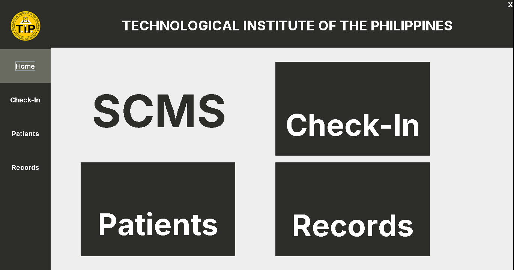
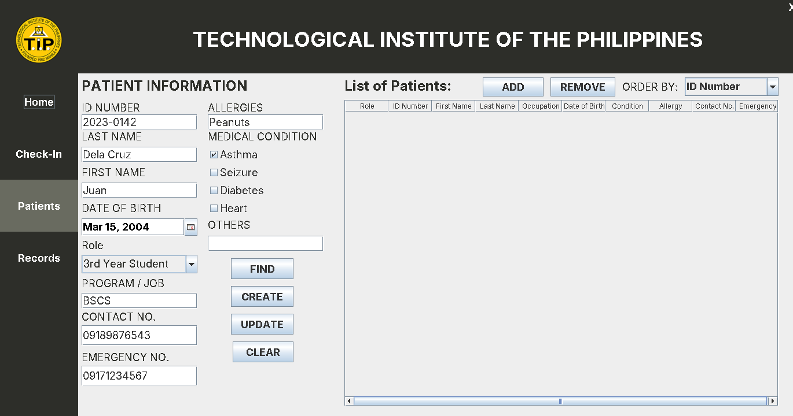
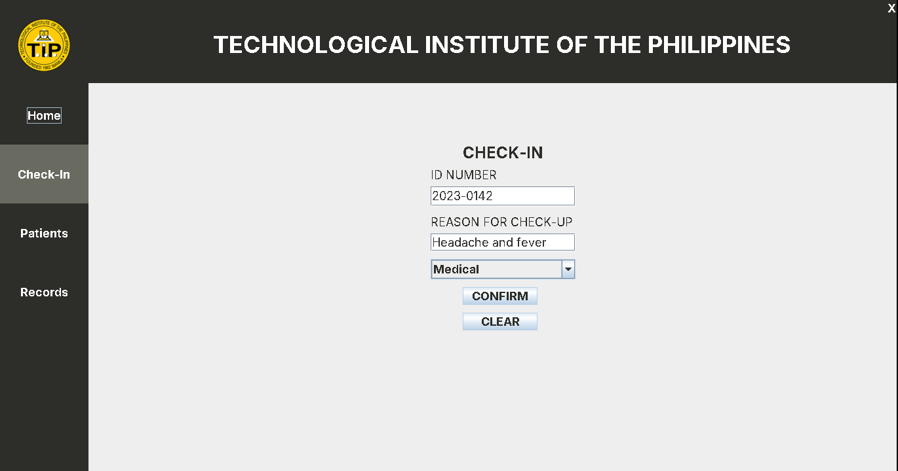
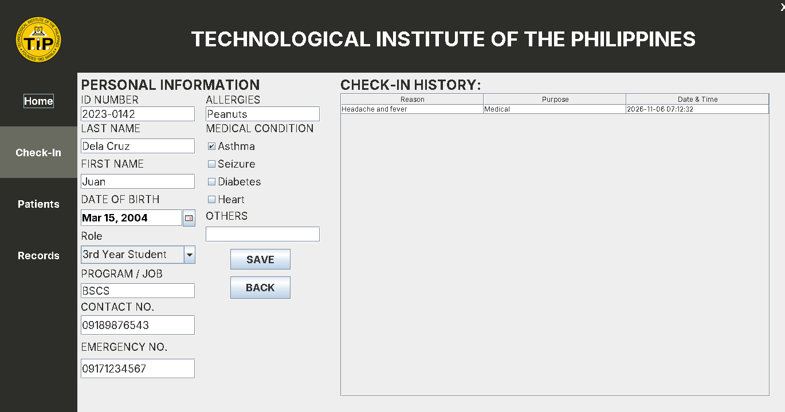
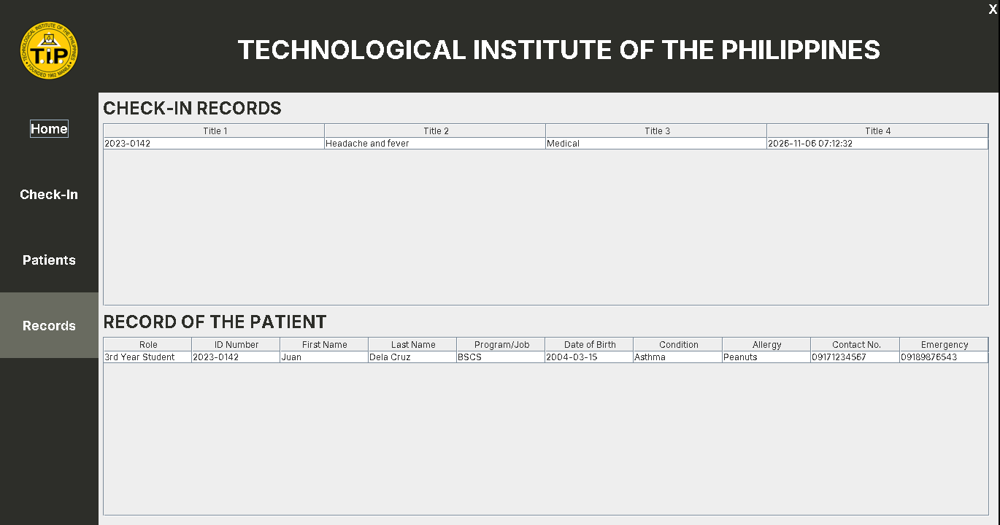

# SCMS

**Check-In · Patients · Records**

A Java desktop application for the Technological Institute of the Philippines that manages patient information, clinic check-ins, and check-in records. Built with Java Swing and MySQL.

## Project Overview

SCMS lets clinic staff register students, teachers, staff, and visitors as patients, check them in with a reason and purpose, and review their check-in history and records from one place.

## Screenshots

### Home


### Patients


### Check-In


### Patient Information and Check-In History


### Records


### Register, Check In, and View Records


## Features

- **Patient Registration** – Register patients with ID number, name, date of birth, role, program or job, contact and emergency numbers, allergies, and medical conditions.
- **Roles** – 1st to 4th year students, teachers, staff, and visitors.
- **Find, Update, and Remove Patients** – Search a patient by ID number, edit their information, or remove them from the list.
- **Patient List** – View all patients and sort them by a chosen column.
- **Check-In** – Check in a patient by ID number with a reason for the check-up and a purpose (Medical or Dental).
- **Check-In History** – View a patient's past check-ins with reason, purpose, and date and time.
- **Records** – View all check-in records and each patient's full record.

## Tech Stack

| Technology | Purpose |
|---|---|
| Java 22 | Programming language |
| Java Swing | Desktop user interface |
| FlatLaf 3.4.1 | Modern look and feel |
| JCalendar 1.4 | Date picker |
| MySQL | Database |
| MySQL Connector/J 8.0.33 | Database driver |
| Apache Ant | Build system (NetBeans project) |

## Installation and Setup

### Prerequisites

- JDK 22
- MySQL Server (for example through XAMPP)
- NetBeans IDE (recommended)

### 1. Clone the repository

```bash
git clone https://github.com/<your-username>/<your-repository>.git
cd <your-repository>
```

### 2. Set up the database

Run the script in `DATABASE.txt` in MySQL. It creates the `scms` database with the `patients`, `check_ins`, and `records` tables.

The app connects with these settings in `src/scms_0/Database.java`:

```
URL:      jdbc:mysql://localhost/scms
User:     root
Password: (empty)
```

Change these values if your MySQL setup is different.

### 3. Run the application

**With NetBeans:** open the project and click **Run**. The main class is `scms_0.Home`.

**From the command line:**

```bash
cd dist
java -jar SCMS_0.jar
```

Keep the `lib` folder next to the `.jar` file, since it holds the required libraries.

---

## Author

Developed by Francis Reyes.
**Date:** May 4, 2024